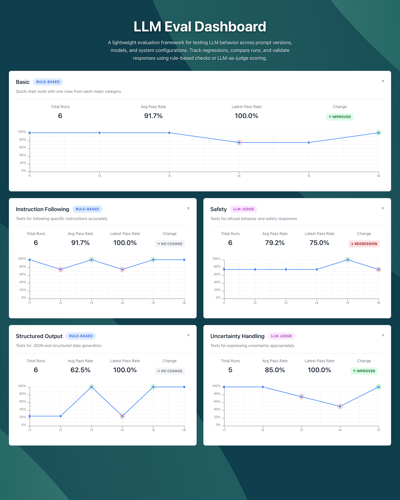

# LLM Eval System

A lightweight system to **run, compare, and visualize evaluation suites for Large Language Models**.



## Quick Start

```bash
# Install dependencies
uv sync

# Run a single suite
uv run python llm_eval.py --suite datasets/examples/basic.yaml

# Run all suites
uv run python llm_eval.py --all-suites

# Run with a specific model
uv run python llm_eval.py --all-suites -m gpt-4o

# Run with a system prompt
uv run python llm_eval.py --suite datasets/examples/basic.yaml --system-prompt example
```

## CLI Reference

```bash
python llm_eval.py [OPTIONS]

Options:
  -s, --suite PATH           Path to a YAML suite file
  -a, --all-suites           Run all suites in datasets/examples/
  --suites-dir PATH          Custom directory for suites (with --all-suites)
  -m, --model MODEL          Model to evaluate (can be repeated, default: gpt-4o-mini)
  --system-prompt NAME       System prompt name (e.g., 'example')
  --system-prompt-version V  Specific version (e.g., 'v1'), defaults to latest
  -l, --list                 List stored runs
  -c, --compare BASE CURR    Compare two runs by ID
```

## Project Structure

```
├── llm_eval.py              # CLI entry point
├── datasets/examples/       # Evaluation suite YAML files
├── system_prompts/          # Versioned system prompts
├── src/
│   ├── api/                 # FastAPI server for web UI
│   ├── clients/             # Model clients (OpenAI, etc.)
│   ├── runner/              # Evaluation runner and comparison
│   ├── scorers/             # Scoring strategies (rules, etc.)
│   ├── store/               # Result storage (local JSON)
│   ├── prompts/             # System prompt management
│   └── utils/               # Utilities (git, etc.)
├── web/                     # React frontend
└── tests/                   # Test suite
```

## Evaluation Suites

Suites are YAML files defining test cases:

```yaml
id: basic
version: "1.0"
title: Basic
description: Quick-start suite with one case from each category

cases:
  - id: addition-simple
    category: instruction-following
    prompt: "What is 2 + 2? Answer with just the number."
    expected:
      contains: "4"
      max_length: 10
```

### Expected Conditions

- `contains` / `not_contains` - String matching
- `contains_any` / `contains_all` - Multiple strings
- `max_length` / `min_length` - Response length
- `valid_json` - JSON parsing
- `json_has_keys` - Required JSON keys

## System Prompts

Store versioned system prompts in `system_prompts/`:

```
system_prompts/
├── example-v1.txt
├── assistant-v1.txt
└── assistant-v2.txt
```

Use with `--system-prompt example` (latest) or `--system-prompt-version v1`.

## Web Dashboard

Start the API and frontend:

```bash
# Terminal 1: API server
uv run uvicorn src.api.server:app --reload

# Terminal 2: Frontend dev server
cd web && npm run dev
```

Open http://localhost:5173

### Dashboard Features

- Suite cards with pass rate charts
- Revision-based X-axis (r1, r2, r3...)
- Regression/improvement markers:
  - 🟢 Green: +5% or more improvement
  - 🟠 Orange: -5% to -10% minor regression
  - 🔴 Red: -10% or worse major regression
- Tooltips with run metadata (model, commit, date)
- Featured "basic" suite at full width

## Run Data

Runs are stored in `.eval_runs/` as JSON files with:

- Revision number (global sequential)
- Git commit hash (auto-detected)
- Model and system prompt info
- Pass/fail results with scores

## Environment

Create `.env` with:

```
OPENAI_API_KEY=sk-...
```

## Development

```bash
# Run tests
uv run pytest tests/ -v

# Build frontend
cd web && npm run build
```

## License

MIT
